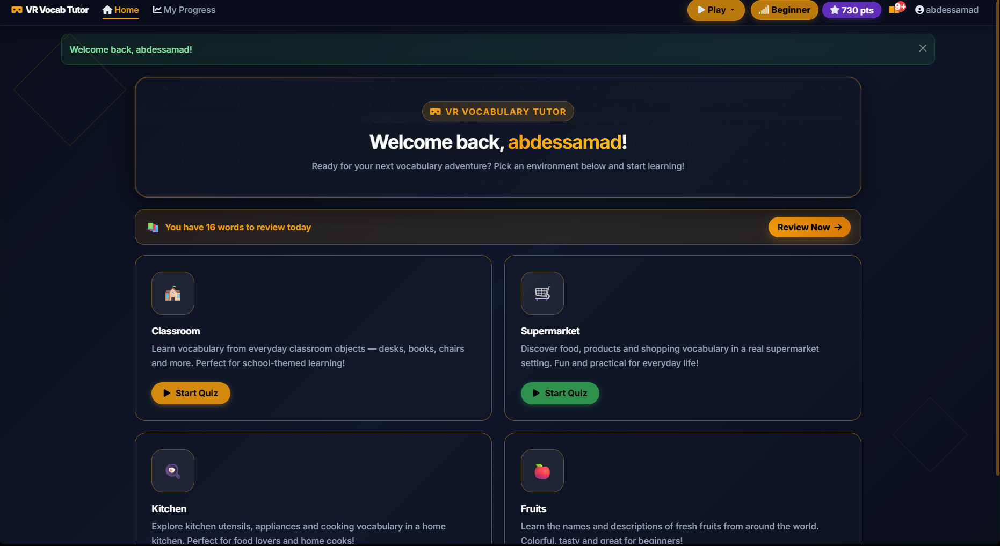
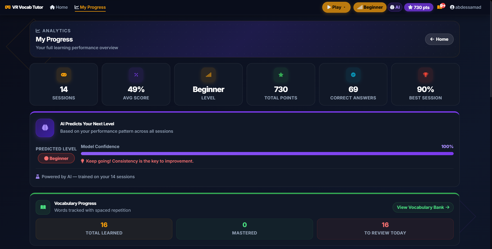
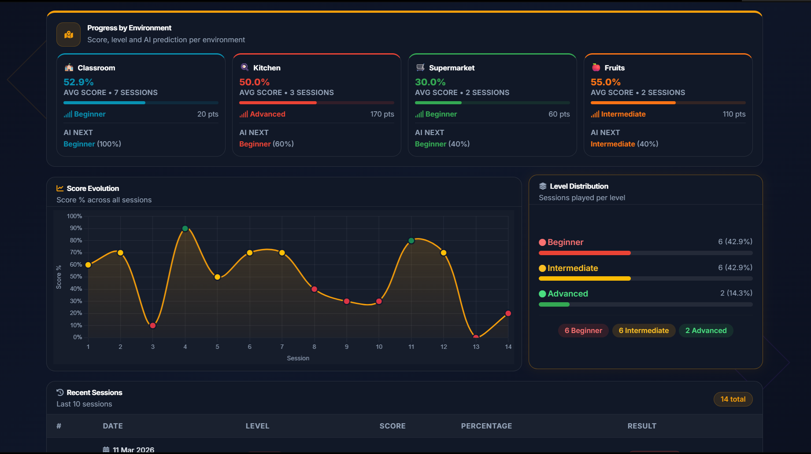
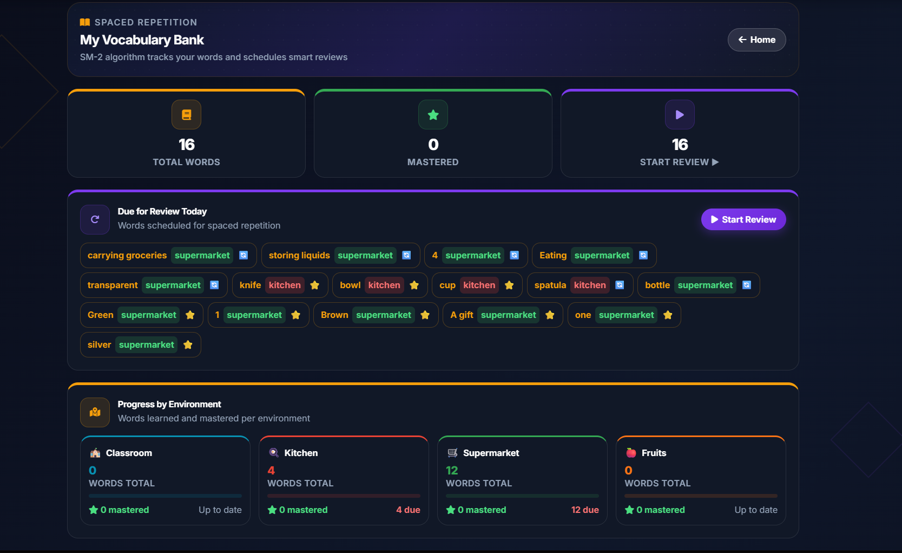
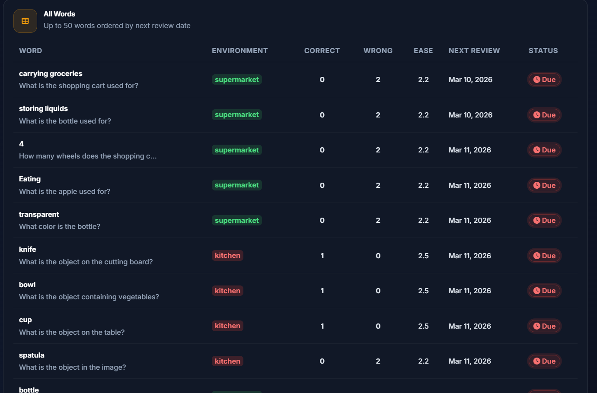
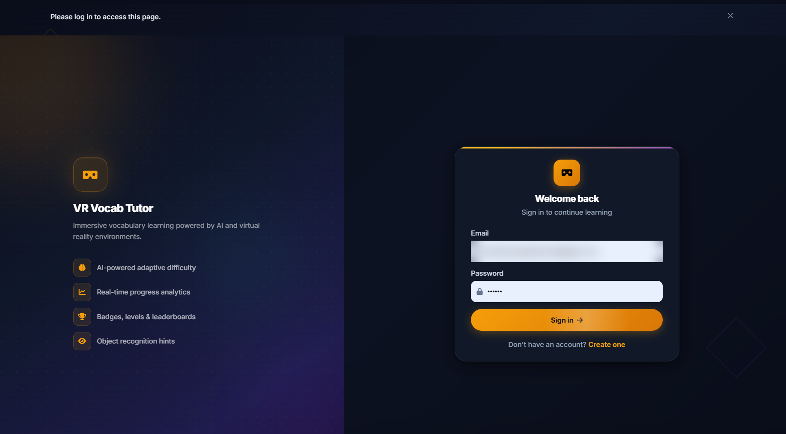

# Vision Vocab Tutor

[](#overview)
[](#how-it-works)
[](#screenshots)
[](#tech-stack)
[](#quick-start)
[](#limitations)
[](#repository-structure)

A web application that teaches English vocabulary from real-world images. An object detector reads each picture, a vision LLM writes a quiz question about what is actually visible, and a spaced-repetition system schedules the words the learner gets wrong.

Personal computer-vision project by Abdessamad Ait Brahim. The interface is branded "VR Vocab Tutor".



## Overview

The learner picks one of four themed environments (classroom, kitchen, supermarket, fruits) and answers 10 multiple-choice questions about a photo. Difficulty adapts to the learner's results, and every word met in a quiz enters a personal vocabulary bank that is reviewed on a spaced-repetition schedule.

**Features**

- Four environments, four levels (beginner, intermediate, advanced, expert), with points and level tracked per environment.
- Optional visual hint: a highlighted circle on the object the question is about.
- Vocabulary bank with SM-2 style scheduling and flashcard review sessions.
- Dashboard with score evolution, level distribution, per-environment stats and a next-level prediction.
- Badges, sound effects and confetti feedback.
- Accounts with hashed passwords and a login lockout after 5 failed attempts (300 s).

## How it works

### Architecture

```
 Browser (Jinja2 + React islands + Chart.js)
        |  HTTP / JSON (/get_question, /submit_answer, /end_session ...)
        v
 Flask app (blueprints: auth, main, quiz)
   |            |                 |
   |            |                 +--> ai_engine.py --> YOLOv8s (local) + DifficultyPredictor
   |            +--> LLM chain: Groq (primary) --> OpenRouter (fallback)
   +--> SQLAlchemy / SQLite: User, QuizSession, Answer, VocabularyWord
```

### Quiz pipeline

```
 random image from static/images/<env>
        |
        v
 YOLOv8s detection --> labels + 3x3 grid positions + spatial relations
        |
        v
 prompt = scene context + difficulty level + image (base64)
        |
        v
 Groq (Llama 4 Scout, vision) --fallback--> OpenRouter (Gemma 3 27B / 12B, Llama 4 Scout)
        |
        v
 JSON: question, 4 choices, answer, hint, explanation --> quiz page
        |
        v
 answers stored --> points, level, badges, vocabulary bank (SM-2) --> dashboard
```

### The computer-vision part (YOLOv8)

`ai_engine.build_scene_context()` runs the pretrained `yolov8s.pt` (COCO, 80 classes) on the quiz image, resized to 640 px wide in memory. It keeps a detection only if it passes four filters: confidence of at least 0.60, label other than `person`, centre outside the top row of the 3x3 grid (usually ceiling or wall), and bounding box covering at least 5 % of the image. For the remaining objects it builds:

- a de-duplicated label list (for example `bowl, cup, knife`);
- pairwise relations (`knife is LEFT OF bowl`), using the dominant axis between box centres;
- a `context_text` sentence injected into the LLM prompt, ending with "Generate questions ONLY about these detected objects";
- the bounding box of the most prominent object, in percent, which the browser draws as the hint circle ("Show Hint").

If YOLO is not installed or finds nothing, the app falls back to a generic prompt and the quiz still works. The weights (about 22 MB) are downloaded automatically by Ultralytics on first run and are not stored in this repository.

### Adaptive difficulty

After each session, a target level is derived from the score (100 % expert, 80 % and above up one level, 50 % and above stay, below 50 % down one level). With at least 3 sessions, a scikit-learn logistic regression (features: score, level, session index, environment; recent sessions weighted more) predicts the next level. With fewer it falls back to the rule on the last three sessions. Displayed confidence is `min(100, 20 x sessions)`.

### Spaced repetition

Each word keeps an ease factor, interval and next review date (simplified SM-2). A word counts as mastered after at least 3 correct answers with ease 2.0 or higher. Due words are reviewed as flashcards, with questions generated by the same LLM chain.

## Screenshots

| Progress dashboard | Progress by environment |
|---|---|
|  |  |

| Vocabulary bank | All words (SM-2) |
|---|---|
|  |  |



## Tech stack

| Layer | Technology |
|---|---|
| Backend | Python, Flask (blueprints), Flask-Login, Flask-Bcrypt, SQLAlchemy, SQLite |
| Vision | YOLOv8s (Ultralytics, pretrained COCO weights), Pillow |
| LLM | Groq API (primary), OpenRouter (fallback) |
| ML | scikit-learn (logistic regression), NumPy |
| Frontend | Jinja2, Bootstrap 5, React 18 (CDN), Chart.js, canvas-confetti |

## Quick start

```bash
git clone https://github.com/abdessamadaitbrahim/vision-vocab-tutor.git
cd vision-vocab-tutor
python -m venv venv && source venv/bin/activate      # Windows: venv\Scripts\activate
pip install -r requirements.txt

cp .env.example .env        # then fill in SECRET_KEY, GROQ_API_KEY, OPENROUTER_API_KEY
python app.py               # http://127.0.0.1:5000
```

The test images are included in `static/images/<env>/`; to add more, set `PEXELS_API_KEY` and run `python download_images.py`, or drop your own `.jpg` files in those folders. `yolov8s.pt` (about 22 MB) is downloaded automatically on first use. Without a Groq or OpenRouter key the quiz cannot generate questions. The login, dashboard and vocabulary pages still run. Needs internet access for the CDN scripts and fonts.

## Limitations

- YOLOv8s is used as is (COCO classes only); it was not fine-tuned, so unusual objects can be missed or mislabelled.
- The difficulty predictor is trained on labels derived from the same score rule, and on a single user's few sessions, so it mostly reproduces that rule. Treat it as a demonstration, not a validated model.
- Questions are LLM-generated and not verified; free OpenRouter models can be rate-limited or inaccurate.
- The included images come from Pexels (see its license) and are a small test set, not a curated dataset.
- No automated tests; scripts and styles load from public CDNs.

## Repository structure

```
vision-vocab-tutor/
|-- app.py                  app factory, schema migrations, security headers
|-- ai_engine.py            YOLOv8 scene context + DifficultyPredictor
|-- config.py               settings read from .env
|-- extensions.py           db, bcrypt, login_manager
|-- download_images.py      fetch environment images from Pexels
|-- models/                 User, QuizSession/Answer, VocabularyWord (SM-2)
|-- routes/                 auth, main (home, dashboard, vocabulary), quiz
|-- templates/              Jinja2 pages (React islands for cards and feedback)
|-- static/                 css, images/<env>/ (Pexels test images)
|-- docs/images/            README screenshots
|-- .env.example
`-- requirements.txt
```